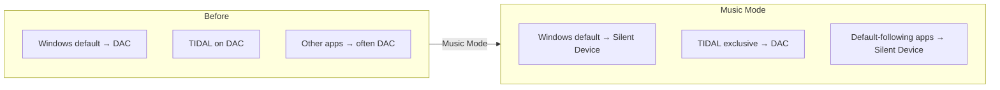
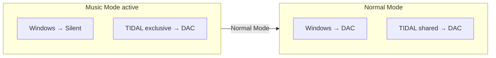

# Audio workflow

How Music Mode and Normal Mode solve the Exclusive Mode problem on Windows, and what the application does when you switch modes.

Related: [README](README.md) · [Technical documentation](TECHNICAL_DOCUMENTATION.md)

---

## Exclusive Mode and Shared Mode

**Shared mode** (typical desktop use): multiple apps can use a playback endpoint through the Windows audio stack.

**Exclusive mode**: an app such as TIDAL may take sole access to an endpoint for its session. While that holds, other apps may fail to open the same device, block, or behave inconsistently—depending on driver, API, and how each app chooses its output.

The **Windows default device** still matters: many apps use the default Console/Multimedia endpoint without picking a device.

**Shared mode** in this app means TIDAL’s `selectDevice(..., "shared")`. **Exclusive mode** means `selectDevice(..., "exclusive")` on your chosen TIDAL Device.

The app sets the system default and TIDAL’s mode through its implemented APIs. It does **not** guarantee every third-party app always follows the default or fails gracefully.

---

## TIDAL Device and Silent Device

| Setting | Role |
|---------|------|
| **TIDAL Device** | Windows playback endpoint for TIDAL (usually your DAC) |
| **Silent Device** | Second endpoint used as **Windows default** during Music Mode (often VB-Audio Virtual Cable) |

In Music Mode, TIDAL is told to use the TIDAL Device **exclusively** while Windows defaults point at the Silent Device. TIDAL does not depend on the Windows default for that exclusive stream.

In Normal Mode, TIDAL uses **shared** mode on the TIDAL Device and Windows defaults return to that device.

---

## Music Mode (what happens when you click it)

From the user’s perspective:

1. Other apps that follow the Windows default begin routing to the **Silent Device**.
2. TIDAL switches to **Exclusive Mode** on the **TIDAL Device** (your DAC).

Internally (`AudioSwitcherService.ApplyMusicModeAsync`):

1. Set Windows default to Silent Device for **Console**, **Multimedia**, and **Communications**.
2. Wait **300 ms**, verify the multimedia default.
3. CDP: `selectDevice(tidalDevice, "exclusive")`.

### Why a silent device

Apps that only follow the default tend to open the Silent Device instead of contending with TIDAL on the DAC. A virtual cable with nothing listening acts as a **discard sink**—playback succeeds for the app without audible output on your speakers.

---

### Avoiding audio recovery problems

A common frustration with exclusive audio access is that other applications may fail to initialize playback or become stuck when attempting to use the same device.

Depending on the application and audio driver, recovering from such situations may require closing applications, changing audio devices manually, or even restarting Windows.

Music Mode is designed to avoid this common conflict by redirecting applications that follow the Windows default device to a separate silent endpoint before enabling TIDAL Exclusive Mode.

This allows users to keep listening to TIDAL on their DAC while avoiding many of the usual desktop audio conflicts.

The exact behavior still depends on the audio driver and how each application manages its playback device.

---

### What it does not fix

- Apps that **pin** the DAC still conflict with TIDAL exclusive mode.
- Apps already open on the DAC may need a restart.
- Hardware paths are unchanged if an app bypasses WASAPI defaults.

---

## Normal Mode (restore desktop audio)

From the user’s perspective:

1. TIDAL returns to **Shared Mode** on the DAC.
2. Windows default moves back to the **TIDAL Device**.

Internally (`ApplyNormalModeAsync`):

1. CDP: `selectDevice(tidalDevice, "shared")`.
2. Set Windows default to TIDAL Device (all three roles), verify.

Order is **TIDAL first, then Windows**—the opposite of Music Mode.

---

## Changing TIDAL Device

After startup, picking a different **TIDAL Device** automatically triggers **Normal Mode** so Windows default and TIDAL shared mode match the new selection. Restoring saved devices on launch does **not** trigger this.

---

## Example: DAC, TIDAL, YouTube, system sounds

**Setup**

- TIDAL Device: `Speakers (Topping DAC)`
- Silent Device: `CABLE Input (VB-Audio Virtual Cable)`

**Music Mode, then YouTube**

1. You enable Music Mode → default to CABLE Input; TIDAL exclusive on DAC.
2. Chrome plays YouTube using the system default → audio goes to CABLE Input (usually inaudible on DAC speakers).
3. TIDAL keeps exclusive playback on the DAC.

**Back to desktop**

1. Normal Mode → TIDAL shared on DAC; Windows default to DAC.
2. New default-following apps share the DAC with TIDAL (as the driver allows).

**System sounds** follow the default roles the app sets—in Music Mode they go to the Silent Device unless Windows or another policy overrides the endpoint.

---

## Mode comparison

| | Music Mode | Normal Mode |
|---|------------|-------------|
| TIDAL mode | `exclusive` | `shared` |
| Windows default | Silent Device | TIDAL Device |
| Apply order | Windows → TIDAL | TIDAL → Windows |
| Requires Silent Device | Yes (≠ TIDAL Device) | No |

---

## Saved mode vs live routing

`ActiveMode` in `settings.json` restores the UI label. The app **does not** re-run Music/Normal orchestration on every startup. After a relaunch, click the mode again if actual routing does not match the display.

Implementation details (including how TIDAL is controlled): [Technical documentation](TECHNICAL_DOCUMENTATION.md) · [TIDAL launch and CDP](TECHNICAL_DOCUMENTATION.md#tidal-launch-and-chrome-devtools-protocol-cdp).
