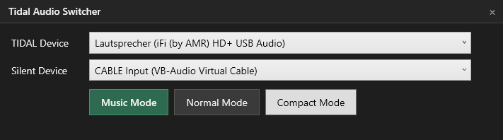

# Tidal Audio Switcher

A lightweight Windows utility that makes it easy to switch between **TIDAL Exclusive Mode** and normal Windows audio playback with a single click.

Perfect for users who listen to music through a dedicated DAC and want to quickly switch between critical listening and everyday desktop use.




---

## Features

* One-click switch between Music Mode and Normal Mode
* Automatically controls TIDAL playback devices
* Switches TIDAL between Exclusive and Shared Mode
* Automatically changes the Windows default audio device
* Compact always-on-top overlay mode
* Remembers selected devices
* Remembers window position and compact mode state
* Automatic TIDAL startup with required launch parameters
* Friendly error handling and diagnostics

---

## Why?

TIDAL Exclusive Mode provides the cleanest possible audio path to a DAC by taking exclusive control of the selected playback device.

However, this can make switching between dedicated music listening and normal desktop usage inconvenient.

Tidal Audio Switcher solves this by providing two simple modes:

### Music Mode

* TIDAL switches to Exclusive Mode
* Windows audio is redirected to a separate Silent Device
* Your DAC is dedicated entirely to TIDAL playback

### Normal Mode

* TIDAL switches back to Shared Mode
* Windows default audio is restored to your selected playback device
* All applications can use the device normally again

---

## Requirements

* Windows 10 or Windows 11
* TIDAL Desktop
* .NET 8 Desktop Runtime
* At least one playback device

Recommended:

* A dedicated DAC for TIDAL playback
* A second playback device or virtual audio device as Silent Device

---

## Silent Device Recommendation

If you only have a single playback device, a virtual audio device works perfectly as a Silent Device.

Recommended:

[VB-Audio Virtual Cable](https://vb-audio.com/Cable/?utm_source=chatgpt.com)

After installation, select the VB-Audio device as your Silent Device inside Tidal Audio Switcher.

---

## Installation

Download the latest release from GitHub Releases.

Extract:

```text
TidalAudioSwitcher-v1.0.zip
```

and start:

```text
TidalAudioSwitcher.exe
```

No additional configuration is required.

The application can be installed anywhere, for example:

```text
C:\Program Files\TidalAudioSwitcher
D:\Tools\TidalAudioSwitcher
```

It does not need to be installed inside the TIDAL directory.

---

## First-Time Setup

1. Start `TidalAudioSwitcher.exe`
2. Select your TIDAL Device
3. Select your Silent Device
4. Activate Music Mode

Your selections are automatically remembered for future launches.

---

## Compact Mode

Compact Mode provides a small always-on-top overlay that allows instant switching between Music Mode and Normal Mode.

The overlay:

* stays above TIDAL
* remembers its position
* remembers its visibility state
* can be moved freely

---

## TIDAL Integration

Tidal Audio Switcher communicates with TIDAL through Chrome DevTools Protocol (CDP).

The launcher automatically:

1. Detects whether TIDAL is running
2. Starts TIDAL with the required parameters if necessary
3. Waits for CDP to become available
4. Launches the Audio Switcher UI

No manual launch arguments are required.

---

## Important Note About Exclusive Mode

TIDAL does not always update its own user interface correctly when playback devices are changed programmatically.

This means:

* Exclusive Mode may be active even if TIDAL does not visually indicate it
* Music Mode always requests Exclusive Mode
* Normal Mode always restores Shared Mode

If in doubt, check the application's log file.

---

## Troubleshooting

### TIDAL Was Started Normally

If Music Mode is unavailable:

1. Close TIDAL
2. Start Tidal Audio Switcher
3. Allow the launcher to restart TIDAL automatically

### Device Missing

This may happen if:

* a DAC was disconnected
* a USB device was renamed
* VB-Audio Virtual Cable was removed

Simply reopen the application and reselect your devices.

### Logs

Diagnostics are written to:

```text
%TEMP%\TidalAudioSwitcher.log
```

Settings are stored in:

```text
%LocalAppData%\TidalAudioSwitcher\settings.json
```

---

## Disclaimer

This project is an unofficial utility and is not affiliated with, endorsed by, or maintained by TIDAL.

TIDAL is a trademark of its respective owners.

Use this software at your own risk.

---

## License

MIT License
