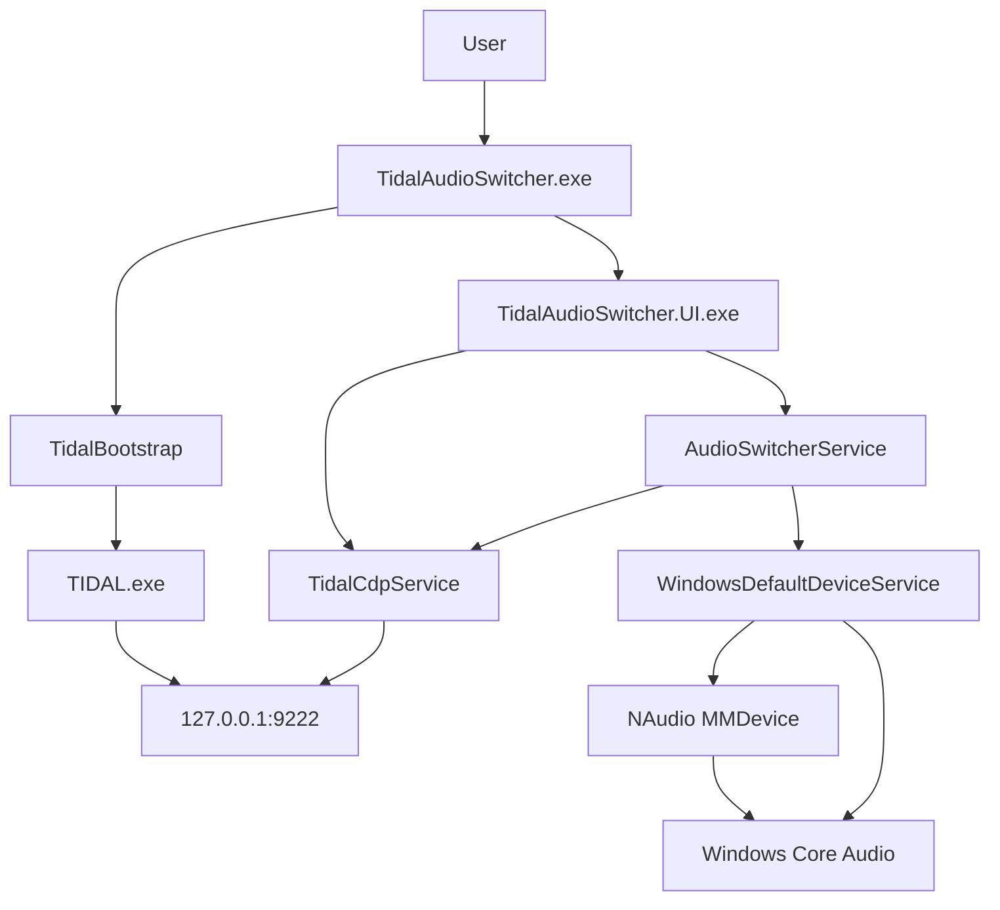
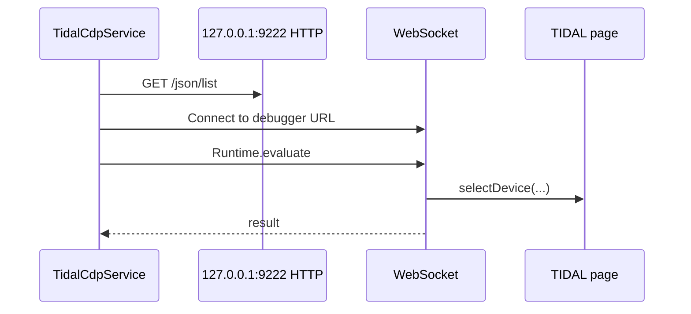
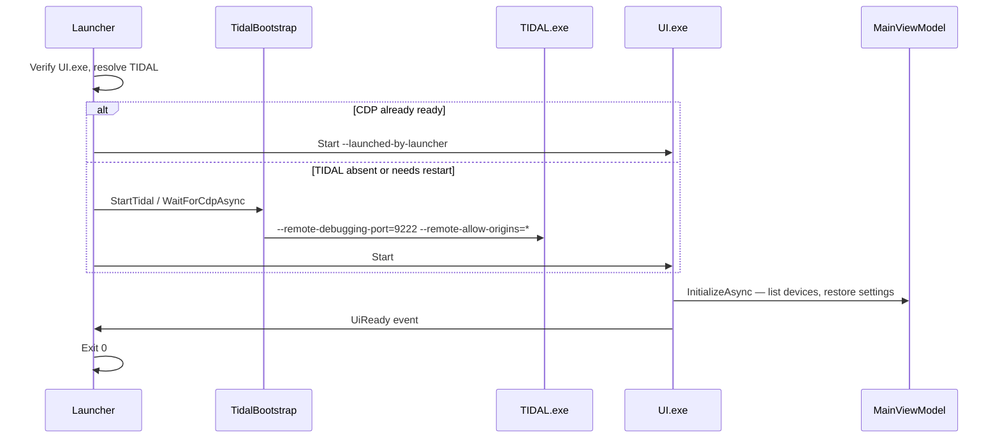

# Technical documentation

Architecture, implementation, and development reference. Behavior described here matches the current C# source unless noted as general Windows/TIDAL behavior.

Related: [README](README.md) · [Audio workflow](AUDIO_WORKFLOW.md)

---

## Overview

| Project | Output | Role |
|---------|--------|------|
| `TidalAudioSwitcher.Launcher` | `TidalAudioSwitcher.exe` | TIDAL + CDP bootstrap, start UI, exit |
| `TidalAudioSwitcher.App` | `TidalAudioSwitcher.UI.exe` | WPF UI, CDP, audio switching |
| `TidalAudioSwitcher.Shared` | `TidalAudioSwitcher.Shared.dll` | TIDAL paths, launch constants, shell helpers |

Stack: **C# / .NET 8** (`net8.0-windows`), **WPF**, **NAudio 2.2.1** (enumeration), **PolicyConfig COM** (default device), **Chrome DevTools Protocol (CDP)** (TIDAL playback mode).



### Two-process architecture

**Launcher and UI are separate executables** by design:

- **`TidalAudioSwitcher.exe`** runs briefly: validates layout, ensures TIDAL is reachable over CDP, starts the UI with `--launched-by-launcher`, waits for a ready signal, then exits.
- **`TidalAudioSwitcher.UI.exe`** hosts the WPF application for the session. It performs mode switches (Windows defaults + CDP calls) and persists settings.

Shared logic (TIDAL path discovery, process start/stop, CDP readiness probes, shell identity constants) lives in **`TidalAudioSwitcher.Shared`** so both processes stay aligned without duplicating bootstrap code.

If the user starts **`TidalAudioSwitcher.UI.exe` directly** (for example from a mis-pinned shortcut), **`UiLauncherRedirect`** relaunches **`TidalAudioSwitcher.exe`** when the launcher is found next to the UI, then exits—so TIDAL still gets the correct startup path.

---

## TIDAL launch and Chrome DevTools Protocol (CDP)

TIDAL’s desktop app is Electron/Chromium-based. The official client does not expose a public API for switching exclusive/shared playback mode. This application instead uses **CDP**: the same remote-debugging surface Chromium uses for developer tools, bound to **localhost**.

### Launch arguments (applied automatically)

When the launcher or **Restart TIDAL** starts TIDAL, `TidalBootstrap.StartTidal` passes exactly these arguments (from `TidalLaunchConstants`):

| Argument | Purpose |
|----------|---------|
| `--remote-debugging-port=9222` | Opens the CDP HTTP endpoint on `127.0.0.1:9222` (`/json/list`, WebSocket debugger URLs). |
| `--remote-allow-origins=*` | Relaxes Chromium’s WebSocket origin checks for connections to that debug port (needed on newer Electron builds when clients connect from local tooling). |

**Ordinary users do not configure these flags.** The launcher and **Restart TIDAL** append them whenever TIDAL is started through the app. You only need to run **`TidalAudioSwitcher.exe`** (or accept a restart when TIDAL was already open the wrong way).

### Why CDP must be enabled

Without `--remote-debugging-port=9222`, nothing listens on port 9222, `TidalBootstrap.IsCdpReady()` fails, and `TidalCdpService` cannot list debug targets or run `Runtime.evaluate` in the TIDAL page. **Music Mode and Normal Mode cannot change TIDAL’s exclusive/shared state**—Windows default switching alone is not enough.

Readiness is defined in code as: HTTP `GET http://127.0.0.1:9222/json/list` returns JSON that includes **`desktop.tidal.com`** (the main TIDAL desktop page target).

### How the app uses CDP

1. **Discovery (HTTP):** `TidalCdpService` fetches `/json/list` and selects a `page` target whose URL contains `desktop.tidal.com` (prefers title `TIDAL`).
2. **Session (WebSocket):** `CdpWebSocketClient` opens a **manual RFC 6455** connection to the target’s `webSocketDebuggerUrl` over TCP. The client **does not send an `Origin` header**, which matches how this app handshakes with Electron/Chromium; launch still includes `--remote-allow-origins=*` for compatibility with stricter builds.
3. **Control (`Runtime.evaluate`):** JavaScript runs in the TIDAL page context, for example:

   ```text
   window.NativePlayerComponent.Player().selectDevice(deviceJson, modeJson)
   ```

   Modes used by the app: `"exclusive"` and `"shared"`. Device `{ id, name }` comes from Windows endpoint metadata (`AudioSwitcherService.ToTidalDevice`).



### When TIDAL is already running without CDP

If **`TIDAL.exe` is already running** but **`IsCdpReady()` is false** (typical when the user started TIDAL from the Start menu or shell without debug flags):

1. The launcher shows **`TidalAlreadyRunningDialog`** and offers to restart TIDAL with the correct parameters.
2. If the user **confirms**, the launcher closes TIDAL gracefully (`CloseMainWindow`, then force kill if needed), starts TIDAL with the debug arguments, and waits up to **45 seconds** for CDP (`WaitForCdpAsync`).
3. If the user **cancels**, the launcher **exits without starting the UI** (return code 0)—mode switching would not work reliably.

The UI path is similar: **`RestartTidalAsync`** closes TIDAL if needed, starts with the same arguments, waits for CDP, then runs **`CheckHealthAsync`**.

If TIDAL is already running **with** CDP ready, the launcher **skips** restart and starts the UI immediately.

### Security note

The debug port is intended for **local application use only** (`127.0.0.1`). Do not forward port 9222 to untrusted networks or expose it beyond the machine; CDP grants deep control over the Chromium instance inside TIDAL.

### Errors and logging

- User-facing CDP failures surface as **`TidalCdpUserException`** (German UI strings in the current build); details go to **`%TEMP%\TidalAudioSwitcher.log`**.
- **`CheckHealthAsync`** distinguishes TIDAL running without CDP, missing `desktop.tidal.com` target (still loading), and connection failures.
- Routine launcher startup does **not** call `CheckHealthAsync`; it assumes CDP after a successful wait. Health checks run after **Restart TIDAL** in the UI.

---

## Launcher, UI, and Shared

### Launcher (`TidalLauncherBootstrap.Run`)

- `ShellIntegration.SetAppUserModelId()` → `TidalAudioSwitcher`
- Requires `TidalAudioSwitcher.UI.exe` colocated with the launcher
- Finds TIDAL: `%LocalAppData%\TIDAL\app-*\TIDAL.exe` (newest `app-*` folder)
- TIDAL + CDP handling: see [TIDAL launch and CDP](#tidal-launch-and-chrome-devtools-protocol-cdp)
- Starts UI with `--launched-by-launcher`, waits on `TidalAudioSwitcher.UiReady` event (**10 s**), then exits

### UI (`Program.Main` → WPF `App`)

- `UiLauncherRedirect`: direct UI start relaunches `TidalAudioSwitcher.exe` when found
- `AppServices` wires `TidalCdpService`, `AudioSwitcherService`, `SettingsService`, `MainViewModel`
- `UiReadyHandshake.SignalReady()` on first `ContentRendered`
- Optional arg: `--compact`

### Shared

- **`TidalBootstrap`:** find/start/close/wait/restart TIDAL; CDP probe (`IsCdpReady`, `WaitForCdpAsync`)
- **`TidalLaunchConstants`:** port `9222`, launch argument strings
- **`ApplicationEntryConstants`:** exe names, `AppUserModelId`, display name
- **`ApplicationPaths.ResolveLauncherExe`:** adjacent exe or dev sibling `Launcher/bin/...`
- **`ShellIntegration`:** AUMID + taskbar relaunch command/icon on UI HWND

MSBuild **`CopyUiApp`** on the launcher project builds the App project and copies output into the launcher `bin` folder for a single deploy directory.

---

## Startup sequence



---

## Windows audio integration

### Enumeration (`AudioEndpointService`)

- `MMDeviceEnumerator.EnumerateAudioEndPoints(Render, Active)`
- Default flag from multimedia default endpoint
- UI filters so TIDAL and Silent selections cannot be the same ID

### Default device (`WindowsDefaultDeviceService`)

- `PolicyConfigFactory` → `SetDefaultEndpoint(id, role)` for Console, Multimedia, Communications
- Fallback interfaces: `IPolicyConfig`, `IPolicyConfigVista`, `IPolicyConfig10`
- 300 ms sleep after set; verify multimedia default; `DeviceSwitchLog` with HRESULTs

NAudio is used for **enumeration and readback**, not for performing the default-device switch.

### Mode orchestration (`AudioSwitcherService`)

Order matters for avoiding glitches and exclusive-mode contention:

| Mode | Order | TIDAL CDP | Windows default |
|------|-------|-----------|-----------------|
| **Music** | Windows first, then TIDAL | `selectDevice(..., "exclusive")` | Silent Device (all three roles) |
| **Normal** | TIDAL first, then Windows | `selectDevice(..., "shared")` | TIDAL Device (all three roles) |

On failure, the service throws **`InvalidOperationException`** with log text; **`ActiveMode`** in settings updates only after a successful, verified switch.

See [Audio workflow](AUDIO_WORKFLOW.md) for user-facing explanation and diagrams.

---

## Configuration persistence

**Path:** `%LocalAppData%\TidalAudioSwitcher\settings.json` (camelCase JSON)

| Field | Purpose |
|-------|---------|
| `tidalDeviceId`, `silentDeviceId` | Windows endpoint IDs |
| `activeMode` | Music / Normal label in UI (**not** re-applied on launch) |
| `compactMode` | Compact overlay |
| `windowLeft`, `windowTop`, `windowWidth`, `windowHeight` | Placement |

Fallbacks on first run: TIDAL device → current default; Silent → name contains `CABLE` or `VB-Audio`, else another device. Legacy key `isCompactView` maps to `compactMode`.

---

## WPF UI and Compact Mode

- **MainViewModel:** commands, device collections, `ScheduleNormalModeAfterTidalDeviceChange` (new TIDAL device after startup triggers Normal Mode)
- **Expanded:** default ~820×230, resizable, not topmost
- **Compact:** 144×54, `Topmost = true`, `ResizeMode.NoResize`; title-bar toggle
- Startup with saved compact: brief expanded load, then `EnterCompactView` on dispatcher idle
- **WindowPlacementHelper:** `MonitorFromRect` — invalid saved position → center screen
- **WindowForegroundHelper:** bring-to-front on startup / compact (best effort)

Icons: `Assets\app.ico` via `Directory.Build.props` and WPF `Icon`.

---

## Taskbar integration

- Both processes: `SetCurrentProcessExplicitAppUserModelID(TidalAudioSwitcher)`
- UI `SourceInitialized`: `ApplyWindowTaskbarIdentity` sets relaunch to **`TidalAudioSwitcher.exe`**, icon `{launcher},0`, display name
- Pin the **launcher** exe, not `TidalAudioSwitcher.UI.exe`

---

## Project structure

```text
TidalAudioSwitcher/
├── TidalAudioSwitcher.sln
├── Directory.Build.props
├── Assets/
├── scripts/Package-Release.ps1
├── README.md
├── AUDIO_WORKFLOW.md
├── TECHNICAL_DOCUMENTATION.md
├── TidalAudioSwitcher.Launcher/
├── TidalAudioSwitcher.App/
│   ├── Services/TidalCdpService.cs
│   ├── Services/Cdp/CdpWebSocketClient.cs
│   ├── Services/AudioSwitcherService.cs
│   ├── Services/WindowsDefaultDeviceService.cs
│   ├── ViewModels/MainViewModel.cs
│   └── MainWindow.xaml.cs
└── TidalAudioSwitcher.Shared/
    └── TidalBootstrap.cs
```

| Data | Location |
|------|----------|
| Settings | `%LocalAppData%\TidalAudioSwitcher\settings.json` |
| Log | `%TEMP%\TidalAudioSwitcher.log` |
| TIDAL install | `%LocalAppData%\TIDAL\app-*\` (read-only discovery) |

---

## Build and local development

**Prerequisites:** **Windows 11** (tested for development and releases). **Windows 10** is not verified by the maintainer. .NET 8 SDK (WPF workload), TIDAL desktop for integration testing.

```powershell
git clone <repository-url>
cd TidalAudioSwitcher
dotnet build TidalAudioSwitcher.Launcher\TidalAudioSwitcher.Launcher.csproj -c Debug
.\TidalAudioSwitcher.Launcher\bin\Debug\net8.0-windows\TidalAudioSwitcher.exe
```

Or `Start Tidal Audio Switcher.bat` (prefers Release bin, then local exe).

While TIDAL runs with the app’s launch flags, developers can inspect CDP targets at `http://127.0.0.1:9222/json/list`.

No automated test project in the solution.

---

## Build and release packaging

Official releases are **framework-dependent**: end users need the [.NET 8 Desktop Runtime (Windows x64)](https://dotnet.microsoft.com/download/dotnet/8.0).

### Package command

From the repository root:

```powershell
.\scripts\Package-Release.ps1 -Configuration Release -Version 1.1.3
```

| Parameter | Default | Purpose |
|-----------|---------|---------|
| `-Configuration` | `Release` | MSBuild configuration |
| `-Version` | `1.0` (script default; override per release) | Folder and ZIP name: `TidalAudioSwitcher-v{Version}` |

The script builds `TidalAudioSwitcher.Launcher` (which triggers the UI build and **`CopyUiApp`** into the launcher output directory), copies runtime artifacts into `release\TidalAudioSwitcher-v{Version}\`, and creates the ZIP.

### What end users receive

- **`TidalAudioSwitcher.exe`** and **`TidalAudioSwitcher.UI.exe`** in the **same folder**, plus dependent `.dll`, `.deps.json`, and `.runtimeconfig.json` files (including **NAudio** assemblies for device enumeration).
- **`Assets/`**, **`README.md`**, and convenience shortcuts (`Tidal Audio Switcher.lnk`, `Start Tidal Audio Switcher.bat`).

**Repository-only:** `AUDIO_WORKFLOW.md`, `TECHNICAL_DOCUMENTATION.md`, source, and `scripts/` are not bundled for end users. **`*.pdb`** and build `bin/`/`obj/` trees are excluded.

### Deploy rules

- Launcher resolves the UI via **`AppContext.BaseDirectory`**—do not split the two executables across directories.
- TIDAL is discovered under **`%LocalAppData%\TIDAL\app-*\`** independently; never install this app inside TIDAL’s folder.

### Maintainer checklist

1. Run `.\scripts\Package-Release.ps1 -Version 1.1.3` (set `-Version` to the release you are shipping; keep `Directory.Build.props` / tags in sync).
2. Upload `release/TidalAudioSwitcher-v1.1.3.zip` as the release asset (path follows `-Version`).
3. Release notes: .NET 8 Desktop Runtime, Windows 11 tested, TIDAL desktop, optional VB-Audio (or similar) for Silent Device.
4. Tag e.g. `v1.1.3` to match the published release version.

---

## Troubleshooting

| Symptom | Likely cause | Action |
|---------|--------------|--------|
| TIDAL.exe not found | No `app-*` under `%LocalAppData%\TIDAL` | Install/update TIDAL desktop |
| CDP / connection errors | TIDAL without debug port or still loading | Start via **`TidalAudioSwitcher.exe`**; **Restart TIDAL**; check log and `/json/list` |
| Launcher closes, no UI | Cancelled restart dialog, CDP timeout, missing UI.exe | Read launcher message; keep exes colocated |
| Verification failed | PolicyConfig HRESULT or race | In-app log + `%TEMP%\TidalAudioSwitcher.log`; retry |
| Port 9222 in use | Another process bound to the port (not handled in code) | Free the port manually |
| UI German messages | Product strings not localized | Behavior unchanged; see log |

Launcher **UiReady** wait is 10 s; the launcher still exits 0 if the UI never signals (edge case).
